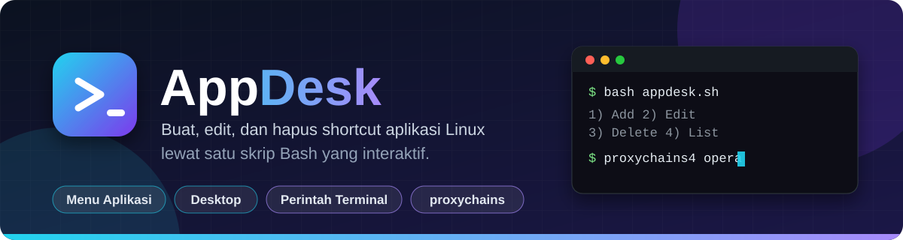
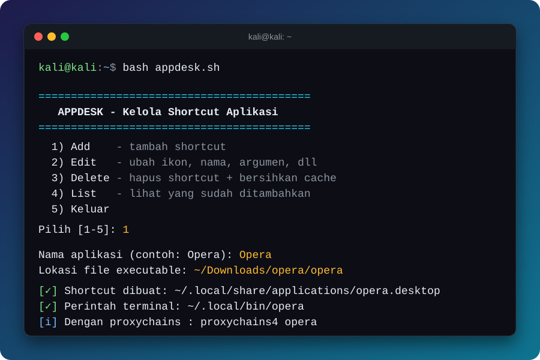

<div align="center">



<br>


**Buat, edit, dan hapus shortcut aplikasi Linux lewat satu skrip interaktif.**

</div>

---

## Kenapa AppDesk?

Banyak aplikasi Linux yang diunduh dalam bentuk folder atau file portabel (contohnya Opera, Brave, aplikasi `.AppImage`, atau hasil ekstrak `.tar.gz`). Aplikasi seperti ini tidak muncul di menu aplikasi dan harus dibuka manual lewat file manager.

**AppDesk** menyelesaikan itu dengan satu perintah:

```bash
bash appdesk.sh
```

Jawab beberapa pertanyaan, dan aplikasi Anda langsung muncul di menu, di Desktop, **dan bisa dipanggil dari terminal**, sama seperti Firefox.

## Fitur

| | Fitur | Keterangan |
|---|---|---|
| ➕ | **Add** | Buat shortcut menu aplikasi, salinan Desktop, dan perintah terminal sekaligus |
| ✏️ | **Edit** | Ubah nama, ikon, lokasi file, argumen, kategori, dan lainnya tanpa membuat ulang |
| 🗑️ | **Delete** | Hapus shortcut, perintah terminal, ikon salinan, dan **bersihkan cache** |
| 📋 | **List** | Lihat semua aplikasi yang pernah ditambahkan lewat AppDesk |
| 🔎 | **Cari otomatis** | Jika path salah, AppDesk mencari file executable di folder home |
| 🖼️ | **Ikon aman** | Ikon disalin ke `~/.local/share/icons/appdesk/` agar tidak hilang jika folder asli dipindah |
| 🧅 | **Siap proxychains** | Perintah terminal langsung bisa dipakai: `proxychains4 nama-aplikasi` |
| 🔄 | **Sinkron otomatis** | Setiap perubahan diterapkan ke menu, Desktop, dan terminal sekaligus |

## Tampilan

<div align="center">

</div>

## Instalasi

```bash
git clone https://github.com/USERNAME/appdesk.git
cd appdesk
bash appdesk.sh
```

Atau, jika ingin bisa dipanggil dari mana saja:

```bash
mkdir -p ~/.local/bin
cp appdesk.sh ~/.local/bin/appdesk
chmod +x ~/.local/bin/appdesk
appdesk
```

> Ganti `USERNAME` dengan username GitHub Anda.

**Kebutuhan:** Linux dengan Bash 4.0 atau lebih baru. Tidak ada dependensi tambahan. `xdg-user-dir`, `gio`, dan `update-desktop-database` dipakai jika tersedia.

## Penggunaan

### 1. Menambah aplikasi (Add)

Contoh untuk Opera yang diunduh sebagai folder:

```
Nama aplikasi        : Opera
Lokasi executable    : ~/Downloads/opera/opera
Lokasi ikon          : (Enter, ikon terdeteksi otomatis)
Kategori             : Network;WebBrowser;
--no-sandbox         : n
Buat perintah terminal : y
Nama perintah        : opera
Salin ke Desktop     : y
```

Hasilnya:

- Opera muncul di **menu aplikasi**
- Ikon Opera muncul di **Desktop**
- Perintah `opera` bisa diketik di **terminal**

### 2. Menjalankan dari terminal

```bash
opera
opera https://example.com
proxychains4 opera
```

### 3. Mengedit (Edit)

Pilih aplikasi dari daftar, lalu pilih bagian yang ingin diubah:

```
 1) Nama tampilan
 2) Ikon
 3) Lokasi executable
 4) Argumen
 5) Komentar
 6) Kategori
 7) Jalankan di terminal
 8) Terima URL/file (%U)
 9) Perintah terminal
10) Salinan Desktop
 S) Simpan & selesai     B) Batal
```

Ketik **S** untuk menyimpan. Shortcut menu, salinan Desktop, dan perintah terminal diperbarui bersamaan.

### 4. Menghapus (Delete)

Delete menghapus:

- shortcut di menu aplikasi
- salinan di Desktop
- perintah terminal
- ikon salinan
- folder cache di `~/.cache/<nama>` (setelah konfirmasi)

Data profil di `~/.config/<nama>` (bookmark, password tersimpan, dll) ditanyakan **terpisah** dan **tidak dihapus secara default**. File aplikasi aslinya juga tidak disentuh.

## Menggunakan proxychains

Karena AppDesk membuat perintah terminal sungguhan, aplikasi bisa langsung dijalankan lewat proxychains:

```bash
proxychains4 opera
```

Tips jika koneksi bermasalah:

- Pastikan proxy sudah terdaftar di `/etc/proxychains4.conf`.
- Aktifkan `proxy_dns` agar permintaan DNS ikut melewati proxy.
- Jika berjalan sebagai root, gunakan opsi **`--no-sandbox`** saat Add atau Edit. Lebih aman lagi, jalankan sebagai user biasa.
- Browser berbasis Chromium sering lebih stabil dengan `proxychains4 -q nama-aplikasi`.

## File yang dibuat

| Lokasi | Fungsi |
|---|---|
| `~/.local/share/applications/<nama>.desktop` | Shortcut menu aplikasi |
| `~/Desktop/<nama>.desktop` | Salinan shortcut di Desktop (opsional) |
| `~/.local/bin/<perintah>` | Perintah terminal (skrip peluncur kecil) |
| `~/.local/share/icons/appdesk/` | Salinan ikon |

AppDesk menandai file buatannya dengan kunci `X-AppDesk=true` di dalam `.desktop`, sehingga **Edit**, **Delete**, dan **List** hanya menyentuh yang dibuat oleh AppDesk. Shortcut lain di sistem Anda tidak terpengaruh.

## Pemecahan masalah

<details>
<summary><b>Ikon di Desktop bertanda peringatan / tidak bisa dibuka</b></summary>

Klik kanan ikonnya lalu pilih **Allow Launching** (GNOME) atau **Trust** (XFCE/lainnya). AppDesk sudah mencoba menandainya sebagai *trusted* lewat `gio`, tetapi sebagian lingkungan desktop tetap meminta konfirmasi sekali.
</details>

<details>
<summary><b>Perintah tidak ditemukan setelah Add (<code>command not found</code>)</b></summary>

`~/.local/bin` belum masuk PATH di sesi terminal yang sedang terbuka. AppDesk sudah menambahkannya ke `~/.bashrc` dan `~/.zshrc`. Buka terminal baru atau jalankan:

```bash
source ~/.zshrc    # atau: source ~/.bashrc
```
</details>

<details>
<summary><b>Aplikasi tidak mau terbuka saat menjalankan sebagai root</b></summary>

Aplikasi berbasis Chromium (Opera, Chrome, Brave) menolak berjalan sebagai root tanpa `--no-sandbox`. Pilih **Edit → 4) Argumen** dan isi `--no-sandbox`.
</details>

<details>
<summary><b>Shortcut belum muncul di menu aplikasi</b></summary>

Logout lalu login kembali, atau jalankan `update-desktop-database ~/.local/share/applications`.
</details>

<details>
<summary><b>Shortcut lama buatan manual tidak muncul di List</b></summary>

List, Edit, dan Delete hanya mengenali shortcut yang dibuat oleh AppDesk. Jalankan **Add** sekali lagi untuk aplikasi tersebut dan timpa file lamanya saat ditanya.
</details>

## Berkontribusi

Saran dan pull request sangat diterima.

1. Fork repositori ini
2. Buat branch: `git checkout -b fitur-baru`
3. Commit perubahan: `git commit -m "Tambah fitur baru"`
4. Push: `git push origin fitur-baru`
5. Buka Pull Request

## Struktur repositori

```
appdesk/
├── appdesk.sh          # skrip utama
├── README.md
└── assets/
    ├── banner.svg      # banner README
    └── terminal.svg    # tampilan menu
```

---

<div align="center">

Dibuat untuk memudahkan pengguna Linux. Jika berguna, beri ⭐ pada repositori ini.

</div>
